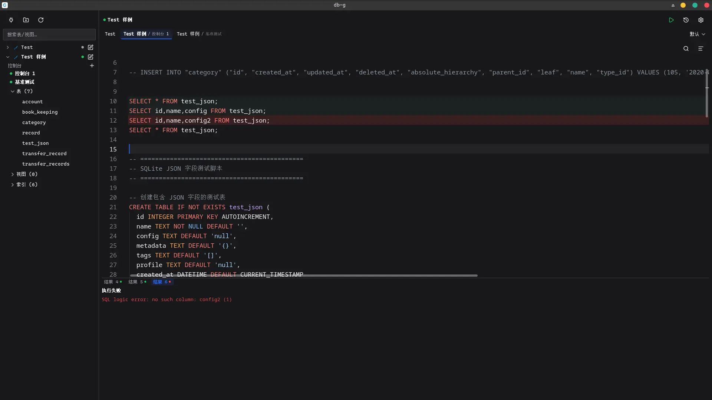

<p align="center">
  
</p>

<p align="center">
  <a href="Readme.md">简体中文</a> · <a href="README.en.md">English</a>
</p>

# DB-G
[](https://awesomemygo.dev/apps/db-g)

A database client built with Go + [mygo](https://github.com/egoist/mygo), modeled after [db-k](https://github.com/Kuangcp/DB-K).
**See [`Roadmap.md`](Roadmap.md) for what is done and what comes next.**



## Why DB-G

**One executable, four data sources, keyboard all the way.**

DB-G is a local-first desktop database client: no runtime to install, no cloud, no data collection. Double-click and you get a complete SQL workbench — connecting, querying, editing, and exporting all happen on your machine.

- **Ready out of the box**: one self-contained executable each for Windows and Linux; no Java, no Electron, no WebView runtime. The UI is drawn natively and starts instantly.
- **Four databases in one window**: SQLite, MySQL, PostgreSQL, and ClickHouse share the same object tree, completion, result grid, and export flow, so you don't have to juggle multiple clients.
- **Designed for the keyboard**: `Ctrl+Enter` to run, `Ctrl+Tab` for the most recent console, `Ctrl+Q` for DDL, `Ctrl+F` to find. Every shortcut can be rebound.
- **Large catalogs stay smooth**: objects load page by page with a 24-hour disk cache; even tens of thousands of objects only query the page you need.
- **Results you can work with**: pin results for comparison, edit cells and commit in a single transaction, inspect JSON as a tree, export to CSV / JSON / SQL INSERT.
- **Your data stays local**: connection passwords are encrypted with AES-256-GCM on this machine, logs are redacted automatically, and there is no telemetry or account.

## Download and run

Releases provide installers (GitHub / Gitee):

| Platform | File | Requirements |
|---|---|---|
| Windows x64 | `db-g-setup-<version>-amd64.exe` | Windows 10 / 11; per-user install with signed auto-updates |
| Linux x64 | `db-g-<version>-linux-amd64.tar.gz` (with `install.sh`) or `db-g_<version>_amd64.deb` | GTK 3 (Arch `gtk3`, Debian/Ubuntu `libgtk-3-0`, Fedora `gtk3`); unpack the archive and run `sh install.sh` to install per user |

Configuration, logs, and consoles live in `~/.config/db-g/` (`%AppData%\db-g\` on Windows);
development builds (`make run` / `make install`, without the `releaseBuild` marker) use `~/.config/db-g.dev/`.

## Features

- [x] Editor: mygo `ui/editor` (SQL highlighting, line numbers, find/replace with Ctrl+F, folding, multi-cursor, undo;
      viewport layout for millions of lines, benchmarks in docs/spike-results.md section A1);
      the editor/result split follows window height; `Alt+D` shows or hides the result pane at any time
- [x] M1: open SQLite files, run SQL asynchronously (Ctrl+Enter), virtualized result grid
      (row numbers / truncation badge / error banner / cancel button / 500-row and 1MB/16MB budgets)
- [x] M2: main layout follows the db-k skeleton (sidebar / top bar / single-row toolbar); connection management
      (JSON persistence / create / edit / delete / status dot); SQLite object tree (lazy loading)
- [x] Sidebar connection tree: folders (nestable, create / rename / delete, duplicate-name check per level;
      deleting moves connections and subfolders to the parent), folder collapse and child counts; each data source
      shows its brand icon; connection and folder rows have no border, hover shows a light background;
      **Ctrl+drag** to reorder and to drop connections or folders into folders;
      the search box filters by connection name / folder name / **already-loaded object name** and auto-expands
      matches (loaded objects only); the connection dialog can pick a parent folder; connection row context menu:
      **Duplicate data source** (copy in the same folder, name deduplicated automatically) and
      **Delete connection** (still asks for confirmation)
- [x] Large-catalog metadata (aligned with db-k): count each object group first, load pages only when a group is
      expanded (1000 per page, 5000 per group); queries run on background threads, so connecting/expanding never
      pulls every object synchronously; the completion catalog reads at most the first 2000 entries, keeping
      60k-table databases from freezing the UI and completion
- [x] Metadata disk cache (aligned with db-k): `<config>/db-g/meta/<connID>.json`, 24h TTL;
      expanding is query-free while the connection fingerprint matches; stale data is used first and refreshed
      in the background; deleting a connection, changing the target address, or using "Reload object tree"
      clears the cache
- [x] Run selection: executes only the SQL selected in the editor, disabled when there is no selection
      (never runs the whole console by accident)
- [x] Query timeout: configurable per data source in the connection dialog (seconds; empty/0 = default 30,
      up to 24h); on timeout the driver's statement is cancelled and the result pane shows
      "Query timed out (Ns), cancelled"
- [x] Data sources: SQLite / MySQL / **PostgreSQL** (pgx) / **ClickHouse** (read-only first) —
      connect, execute, object tree, column catalog (with primary keys), completion, export; all four drivers
      support object DDL viewing; PostgreSQL / MySQL / ClickHouse support multiple schemas;
      PostgreSQL supports writes, ClickHouse is read-only
- [x] Consoles + workspaces: multiple named consoles per data source, each backed by
      `~/.config/db-g/consoles/<connectionID>-<consoleID>.sql`; tab bar / workspace switching, debounced auto-save,
      Ctrl+S to save immediately, restore workspaces with console text and cursor after restart.
      **Closing a tab (×) only removes it from the current workspace, the file stays**; the right-click
      "Delete…" item removes the metadata and .sql. The sidebar lists every console of each data source
      so you can reopen them. Tabs show "data source / console" (console name omitted when there is only one);
      overflowing tabs move into a More menu at the end of the tab bar, and the workspace switcher stays visible;
      **new consoles are created only from the entry under each data source in the sidebar**.
      **Hold Ctrl and drag a tab** to reorder within the workspace; **Ctrl+Tab** switches between the two
      most recently used consoles (Alt-Tab style).
- [x] P1 daily query loop:
      **multi-statement execution** (run the selection if there is one, otherwise the statement under the cursor;
      sequential, stops on first error, one result tab per statement, gutter markers for statement state);
      **result grid**: **cell-level selection** (two levels of highlighting: selected cell darkest, its row lighter,
      other rows alternate zebra stripes; `Ctrl+C` copies the selection, a single cell copies just that cell),
      copy the whole row, right-click "Copy row → INSERT";
      right-click a multi-row/multi-column selection for the **Copy selection** submenu
      (TSV / TSV with header / CSV), or **Export selection** to CSV / JSON / SQL INSERT;
      **View full content**: valid JSON renders as a collapsible tree (sorted keys, expand/collapse, type coloring,
      copy the raw text); other content shows as text; right-click a header to sort (NULLs always last) and filter
      each column; **Fetch more** (paginated append through a derived table); **Export** to CSV / JSON / SQL INSERT
      (including full streaming export that re-runs the query);
      **Pin results**: the pin button keeps a query result as the leftmost result tab (query results only,
      up to 10); pinned tabs stay on the left across new runs while new results append to the right; each console
      keeps its own pins, which are in-memory and disappear on restart;
      **SQL history** (one `history/<connectionID>.jsonl` per data source, capped at 5000 entries with a lazy
      6000→5000 trim; the panel shows the latest 100 with insert/copy, the full file is linked in its title);
      **object tree**: double-click inserts a preview SQL statement (reuses an existing console for that data source and appends a semicolon-terminated `SELECT ... LIMIT 200`; creates one only when none exists; never runs it automatically), right-click for DDL (read-only SQL editor: conservative
      formatting + syntax highlighting + copy the mouse selection; `Ctrl+Q` also opens it for the selected object);
      **conservative SQL formatting** (only whitespace and keyword case, undoable)
- [x] M3 (partial): multi-statement execution + SQL history (statement progress/gutter state done, history panel done)
- [x] P2 writes (M6): results from a single table with a primary key are editable — edit cells in a dialog,
      add rows, delete rows, undo; before committing every statement is previewed as parameterized SQL and executed
      in **one transaction**; if the affected row count ≠ 1 the whole transaction rolls back;
      JOINs / views / primary keys missing from the result / aliased expression columns are read-only
      (the toolbar shows why); writes require the driver to declare `CapEditableResult` and implement
      `Transactional` (both sqlite and mysql do)
- [x] Autocomplete (A2): SQL keywords/functions/types plus tables/views of the current data source; pops up while
      typing, `Ctrl+Space` triggers it explicitly; table/view catalogs are cached per connection (TTL 5 minutes;
      "Refresh completion cache" in the top-bar Settings); column completion follows the tables referenced by the
      **statement/subquery under the cursor** (FROM · JOIN · UPDATE · INTO, with multi-table JOINs, aliases and CTE
      expansion; **inside function/expression parentheses (sum, avg, coalesce, WHERE (…)) columns are still offered**;
      no columns when the statement references no table); after FROM/JOIN/UPDATE/INTO the relation-name position
      offers tables/views first; adjacent statements missing a semicolon are separated at line-leading
      `SELECT`/`INSERT` keywords so the next statement's tables do not leak into the current completion
- [x] AI assistant (phase 1): a collapsible right panel for Chat-to-SQL, using local Ollama by default or any
      OpenAI-compatible service; only schema + the current SQL are sent by default, with sample rows, history
      and error logs behind separate switches; the exact context can be previewed before sending; replies stream,
      and generated SQL is inserted only when the user clicks "Insert SQL"; Settings → AI configures the base URL,
      model and API key (encrypted on this machine); conversations are saved per workspace
- [x] Execution plans: the top-bar "Execution plan" action EXPLAINs the current statement/selection and shows
      a unified plan tree in the result pane, colored by cost with rows/actual timing; supports SQLite
      `EXPLAIN QUERY PLAN`, PostgreSQL JSON, MySQL JSON/TREE and ClickHouse JSON, falling back to the raw result
      when parsing fails; ANALYZE asks every time and is limited to SELECT/WITH; the plan tree can be sent to AI
      for diagnosis
- [x] SQL error fix: "AI fix" on a failed execution sends the failed SQL, driver error and involved table schemas;
      the suggestion is shown as a diff and only applied to the editor after "Apply fix" or "Apply and run"; a reply
      without a SQL code block is reported as an error
- [x] Destructive SQL guard: local deterministic rules flag UPDATE/DELETE without WHERE, tautological
      conditions, and DROP/TRUNCATE; a dialog warns by default, and a connection profile can enable "block
      destructive SQL"; AI is never in the allow/deny path
- [x] Security and polish (P4): connection passwords **encrypted with AES-256-GCM on this machine**
      (key `<config>/db-g/secret.key`, 0600; existing plaintext is encrypted and written back on load; if a changed
      key cannot decrypt, the app warns and asks you to re-enter); connection profile **export/import**
      (no passwords by default; imports deduplicate and remap conflicting ids; available in Settings);
      "Copy" in the connection dialog copies key: value pairs, **including the plaintext password**;
      "Test connection" can be **cancelled** while waiting;
      sidebar status dots: grey = not connected, green = connected, red = open failed (hover for the reason).
- [x] Logging/diagnostics (P0): `~/.config/db-g/logs/YYYY-MM/YYYY-MM-DD_N.log`
      (plain text: time, level, tag, message, key=value; one file per launch, `0600`);
      records startup / connect / execute (SQL truncated to 200 characters, no results) / console / completion load failures / panic
      stacks; Settings can open the log directory. DSNs and password fields are redacted automatically.
- [x] Shortcuts: one action table with rebinding (`keymap.json`; click "Record" in Settings);
      `Ctrl+Enter` run, `Ctrl+S` save, `Ctrl+C` copy (text in the editor, cell in the result grid),
      `Ctrl+Y` duplicate the current line, `Ctrl+D` delete the current line/selection, `Ctrl+Shift+F` format,
      `Ctrl+Tab` switch to the most recent console, `Alt+D` toggle the result pane, `Ctrl+Q` view DDL of the
      selected object
- [x] Appearance: follow system / light / dark; accent color (default / presets / custom hex), density,
      corner radius, UI font size, applied instantly and saved to `~/.config/db-g/theme.json`; theme files can be
      exported/imported (with app/version validation, invalid fields ignored individually); the Appearance section
      in Settings previews changes live
- [x] External SQL files: drop a `.sql` file or use “Open SQL file…” in the top bar, pick a data source,
      and it opens as a temporary console (the same path is reused and the file is never copied);
      8 MiB limit, non-UTF-8 / NUL-containing / non-`.sql` files are rejected. Edits are debounce-saved back
      to the original file, preserving its BOM, line-ending style, and permissions.
      Disk changes are checked every second, on window focus, and before execute/save — a clean buffer reloads
      automatically, while local edits pause autosave and show a banner with
      "Reload / Keep local / Save as…", and execute/save ask first. Writes verify the on-disk content and never
      overwrite an external edit; a missing file is not recreated silently (offer recreate/save-as) and is removed
      from the workspace at startup; deleting the console only unbinds it and keeps the user's file
- [x] Linux self-install/upgrade (release builds only): when `~/.config/db-g/bin/db-g` or `version` is missing,
      or the running version is newer, an install/upgrade icon appears next to Settings in the top bar;
      confirming atomically copies the current executable to `bin/db-g`, writes `version`
      (`build=10000` plus the display version), and creates
      `~/.local/share/applications/db-g.desktop` and `~/.local/share/icons/db-g.png`
      (the desktop entry uses the icon's absolute path, so no icon-cache refresh is needed);
      paths honor `XDG_CONFIG_HOME` / `XDG_DATA_HOME`
- [x] Releases and auto-updates: pushing a `v*` tag builds Linux/Windows in GitHub Actions, signs update
      archives and publishes a Release; the app ships mygo's native update window, checks automatically,
      verifies signatures, and applies the update on next launch
- [x] Settings window: left/right layout (Appearance / Fonts / Shortcuts / Connection profiles / Logs / Developer),
      version in the bottom-left corner; separate fonts (family and size) for the editor, the result area, and
      the rest of the UI, with live previews, saved to `~/.config/db-g/fonts.json` (old `editor.json` migrates)
- [ ] M7: editor formatting (completion is done: keywords/tables/columns)

## Build and test

```bash
export GO=$GOBIN/go1.27.3
CGO_ENABLED=0 $GO run .     # interactive window (cgo is disabled everywhere: linking with cgo hits a .sframe issue here)
CGO_ENABLED=0 $GO test -p 1 ./... # full suite (includes editor and result-grid benchmarks; -p 1 keeps parallel packages from starving the CPU and failing benchmarks)
CGO_ENABLED=0 $GO test ./ui -run 'TestEditor.*Perf' -v   # editor benchmarks only
$GO tool mygo vet .         # UI lifecycle checks

make release                # builds Windows / Linux release binaries into dist/ (version from the git tag)
```

"Settings" in the top bar opens a separate singleton settings window: editor info (lines/bytes/version) and
3k/12k/100k demo presets (written to the active console and saved immediately, for performance testing).
