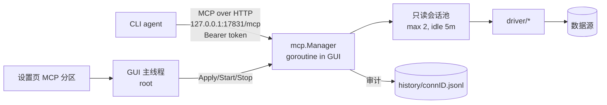

# db-g MCP 只读查询服务设计

> 状态：草案（未排期）。目标读者：后续实现者。
> 结论先行：MCP server 作为 GUI 进程内协程运行，对外只暴露 **127.0.0.1 上的 Streamable HTTP**；
> 只读围栏以「会话级只读」为边界、SQL 分类器为提前拦截；审计写进现有 `history/<connID>.jsonl`。
> **进程内协程的代价是：只支持能配置 HTTP MCP 的客户端**，只支持 stdio 的客户端需要 Phase 2 的
> `db-g mcp-bridge` 薄转发进程。

## 1. 目标与非目标

### 目标

| 目标 | 说明 |
|---|---|
| 让 CLI coding agent 查开发库 | 列 schema/表/列、看 DDL、跑只读 SQL、看执行计划 |
| 复用现有档案 | 直接读 `connections.json` + `secret.key`，不新增一份 DSN |
| 只传名字 | 工具参数用数据源**名称**寻址；不暴露 host/user/path/DSN |
| 默认关闭、按连接授权 | 未在设置里勾选的数据源对 MCP 不可见 |
| 可审计 | 每次调用（含被拒绝的）进历史；人在历史面板能看到 |
| 不写库 | 只读是会话级强制，不是提示词约束 |

### 非目标

- 写操作、DDL 变更、事务控制。
- 向 agent 暴露历史记录、密码、连接串、`secret.key`。
- 监听非 loopback 地址、多用户/多令牌、TLS。
- GUI 未运行时继续提供 MCP（不做后台常驻进程）。
- 自己实现 MCP 协议（用官方 `github.com/modelcontextprotocol/go-sdk`，pin `v1.8.0`）。

## 2. 架构与生命周期



- 新包 `mcp/`：只依赖 `app` + `engine`（不 import `ui`/`mygo`），`ui/root` 持有 `*mcp.Manager`。
- **GUI 启动时若设置里 `enabled=true` 就启动 listener**；只开端口，不连任何数据源（符合
  「启动不连库」约定）。首个工具调用才懒打开会话。
- 设置变更 → `root` 调 `Manager.Apply(cfg)`：热更新允许列表与令牌；端口/开关变化则
  `Stop()` + `Start()`。GUI 退出时 `Manager.Close()`（关会话、HTTP `Shutdown` 5s）。
- 端口占用/监听失败**不能让应用崩溃**：状态显示在设置页（红字 + 端口），MCP 保持停用。
  第二实例启动（已有单实例转发逻辑）不另开 listener。

### 协议与客户端配置

GUI 进程无法为外部 agent 提供 stdio，因此传输固定为
[MCP Streamable HTTP](https://modelcontextprotocol.io/specification/2025-06-18/basic/transports)：
`mcp.NewStreamableHTTPHandler(getServer, &mcp.StreamableHTTPOptions{...})`，`getServer` 返回同一个
`*mcp.Server`。工具在 `NewServer` 时静态注册（`mcp.AddTool`）。

用户级 agent 配置（设置在「MCP」分区提供一键复制）：

```json
{
  "mcpServers": {
    "db-g": {
      "type": "http",
      "url": "http://127.0.0.1:17831/mcp",
      "headers": { "Authorization": "Bearer <token>" }
    }
  }
}
```

**不要写进仓库的 `.mcp.json`**（令牌会进 git）。Phase 2 提供
`db-g mcp-bridge`：stdio ↔ 本地 HTTP 的无状态转发（读 `mcp.json` 拿端口/令牌），
供只支持 `command` 型 MCP 的客户端使用；真正的 server 仍跟随 GUI。

## 3. 安全模型

| 威胁 | 对策 |
|---|---|
| 同机其他进程扫端口直接查询 | 只绑 `127.0.0.1`；所有请求校验 Bearer token（constant-time 比较），否则 401 |
| 浏览器 DNS rebinding | 校验 `Origin`：缺失或仅允许 `http://127.0.0.1:<port>` / `http://localhost:<port>` |
| Prompt injection 诱导写库 | 会话级只读 + 分类器双保险；MCP 不提供任何写工具 |
| 诱导读取敏感表 | 每连接默认不暴露；文档建议为 MCP 配只读 DB 账号 |
| 令牌泄漏 | 落盘用既有 `Vault` 加密（同 AI API Key 的 `enc:v1:` 模式）；设置页可一键轮换 |
| agent 自己读 `connections.json` | **不在防护范围内**：同用户可读。隐藏 DSN 只是提示词卫生，不是边界 |

明确写进文档：**「不传 host/DSN」的价值是避免敏感串进模型上下文，不是安全边界。**

## 4. 只读围栏（分两层）

### 4.1 边界层：会话级只读（必须）

新增 `engine.Profile.ReadOnly bool`，驱动在 `Open` 时施加，不写回 `ConnProfile`：

| 驱动 | 施加方式 |
|---|---|
| SQLite | DSN 追加 `_pragma=query_only(1)`（兜底 `PRAGMA query_only=ON`；MCP 分类器禁改回） |
| PostgreSQL | `SET default_transaction_read_only = on` + `SET SESSION CHARACTERISTICS AS TRANSACTION READ ONLY` |
| MySQL | `SET SESSION TRANSACTION READ ONLY`（注意不挡 `SELECT … INTO OUTFILE` / `LOAD DATA`，由分类器拒） |
| ClickHouse | DSN 带 `readonly=1`（服务端强制，无法自我提权） |

> 顺带收益：GUI 也可以有「只读连接」，不必等 MCP。

### 4.2 护栏层：SQL 分类器（提前报错）

在 `app/guard.go` 增加 `ReadOnlyIssue(sql string) string`（空串 = 放行），复用
`SplitStatements` + `lexSQL`：

- 只允许单条语句；
- 顶层首词白名单：`SELECT` `WITH` `SHOW` `DESCRIBE` `DESC` `EXPLAIN` `VALUES` `TABLE`；
- `WITH` 允许（数据修改型 CTE 会被会话只读挡住），但全文（跳过字符串/注释后）出现
  `INSERT` `UPDATE` `DELETE` `MERGE` `REPLACE` 即拒；
- 任意位置拒：`INTO OUTFILE`、`INTO DUMPFILE`、`LOAD`、`CALL`、`SET`、`PRAGMA`、`ATTACH`、
  `DETACH`、`COPY`、`GRANT`、`REVOKE`、`CREATE`、`ALTER`、`DROP`、`TRUNCATE`；
- 多语句直接拒（`SELECT 1; DELETE …`）。

分类器是**提示性围栏**：绕过它也不能绕过 4.1。测试必须同时覆盖两层。

## 5. 工具面

工具参数中的 `connection` 是数据源名称；重名档案**拒绝暴露**（报「请先改名」）。
连接名不是秘密，错误信息里可以列出当前允许的名称。

| 工具 | 参数 | 返回 / 依据 |
|---|---|---|
| `list_connections` | — | `[{name, kind, tags}]`；**不含 host/user/path/database** |
| `list_schemas` | `connection` | `SchemaLister.Schemas`；单库驱动返回空数组 |
| `list_tables` | `connection, schema?` | `ObjectLister`/`SchemaLister`，只回表+视图名 |
| `describe_table` | `connection, schema?, table` | `ColumnLister` → `{name,type,nullable,primaryKey}` |
| `table_ddl` | `connection, schema?, table` | `ObjectDDLer`（`CapObjectDDL`），截断 8 KiB |
| `run_query` | `connection, sql, max_rows?` | 只读结果，见 §6 |
| `explain_query` | `connection, sql` | `PlanExplainer`（`CapExplain`），原始/解析文本截断 16 KiB |

- 能力位不足时工具仍注册，但调用返回明确错误（「该数据源不支持执行计划」），
  不要按连接动态删工具（工具列表频繁变化会污染客户端上下文）。
- 元数据列表不落盘缓存：进程内 60s TTL 即可，避免 `meta/*.json` 的 24h 陈旧让 agent 看到过期 schema。

## 6. 结果与预算

`run_query` 的返回结构：

```json
{
  "columns": [{"name": "id", "type": "INTEGER"}],
  "rows": [[1, "alice"], [2, null]],
  "rowCount": 2,
  "truncated": false,
  "elapsedMs": 12
}
```

| 限制 | 值 | 说明 |
|---|---|---|
| 行数 | `max_rows`，默认 100，上限 200 | 越界夹到上限 |
| 序列化体积 | 32 KiB | 超出置 `truncated=true`，附提示「请用聚合/加 WHERE」 |
| 单元格 | 4 KiB | 超出截断并标 `…` |
| 查询时长 | `min(profile.QueryTimeout, 30s)` | 0 视为 30s |

> `engine.SetResultBudgetMB` 是进程级全局值，GUI 与 MCP 同进程，**不能**为 MCP 单独下调；
> MCP 在拿到 `QueryResult` 后自行截断（行数/字节），全局预算保持 GUI 设置值。

值归一化：`nil`→`null`；`time.Time`→RFC3339Nano；`[]byte`（合法 UTF-8 文本）→字符串，
否则 `{"$base64": "…"}`；`NaN/Inf`→字符串。

取消：MCP 请求 ctx 取消时调用 `session.Cancel()`（驱动的 `Cancel` 已有实现），
并记录审计 `ok=false, err="cancelled"`。

## 7. 会话管理

MCP 使用**自己的会话池**，不复用 `root.sessions`：

- 原因：`root` 状态只能在 UI 线程读写；复用会引入跨线程访问与 LRU 互踩。
- 池上限 2（`mcpMaxSessions`），按连接 ID 懒打开；空闲 5 分钟关闭；全忙时排队（不超限）。
- 打开超时 5s（与 `openTimeout` 一致）；打开失败记日志 + 返回脱敏错误。
- 配置文件转换统一走新函数 `app.EngineProfile(p ConnProfile, readOnly bool) engine.Profile`；
  `ui.engineProfile()` 改为调用它，保证 GUI/MCP/测试连接三处一致（现状三处已收敛，新增第四处不另写）。
- 不修改 `ConnProfile`；MCP 连接在历史里用 `ConnName` 标记，不影响 GUI 的活动项。

## 8. 审计

复用 `app.History`，`HistoryEntry` 加字段（JSONL 向后兼容）：

```json
{"ts":1763100000000,"connID":"c1","connName":"dev-db","sql":"SELECT ...","durMS":12,
 "ok":true,"rows":2,"source":"mcp","client":"claude-code/1.2","tool":"run_query"}
```

- `source`：`""`（GUI，旧记录缺字段即此值）或 `mcp`。
- `client`：MCP `initialize` 的 `clientInfo.name/version`（SDK 会话可取）；未知为空。
- `tool`：工具名。
- **被分类器/只读拒绝的调用也要写一条**，`ok=false`、`err` 为原因；这是审计重点。
- 日志用 `app.LogInfo/LogWarn("mcp", …)` 记 tool、数据源名、耗时、行数、截断、错误类型；
  **不记 SQL 正文**（正文在历史里），不记令牌、DSN、密码。`RedactDSN` 处理所有回给 agent 的错误。
- UI：历史面板后续加 MCP 徽标（Phase 3）。

## 9. 设置与持久化

新文件 `mcp.json`（`app.MCPPrefs`），落盘位置同其他 prefs：

```json
{
  "enabled": false,
  "port": 17831,
  "allow": ["<conn-id>"],
  "tokenEnc": "enc:v1:…"
}
```

| 字段 | 默认 | 说明 |
|---|---|---|
| `enabled` | `false` | 总开关；关闭即停 listener |
| `port` | `17831` | 固定端口便于客户端配置；被占用时报错，不自动换端口 |
| `allow` | 空 | 允许的数据源 ID 列表；空 = 全部拒绝 |
| `tokenEnc` | 空 | 首次启用时生成 32 字节随机令牌并用 `Vault` 加密 |

设置页新分区「MCP」（`settingsSections()` 加一行，插在「AI」之后）：
启用开关、端口、允许的数据源多选（复用 `connKindRow` 风格）、令牌「显示/复制/轮换」、
「复制 agent 配置」按钮、监听状态行（运行中 + URL / 已停止 / 错误原因）。

## 10. 测试

| 层 | 用例 |
|---|---|
| `app` 分类器 | 表驱动：`SELECT` 放行；`WITH … DELETE`、`SELECT … INTO OUTFILE`、`PRAGMA`、多语句拒绝；字符串/注释里的关键字不误伤 |
| `engine`/驱动 | SQLite：`ReadOnly` 会话执行 `CREATE/INSERT` 必须报错；PG/MySQL/CK 用现有集成开关，无环境则 skip |
| `mcp` 包 | `httptest` + SDK 客户端：无令牌 401；`tools/list` 工具齐全；`run_query` 成功；写语句被拒且审计落盘；`max_rows` 截断；未授权连接被拒；重名连接报错 |
| `ui` | headless：设置页开关调用 `Manager.Start/Stop`；状态文案；旧 `mcp.json` 缺失字段按默认值处理 |
| 手动 | 用真实 agent 连一次 `explain_query`；关闭 GUI 后客户端报连接失败（预期） |

验证命令照 AGENTS「验证方式」，新增包后 `gofmt -l .` 必须为空，`go tool mygo vet .` 必须过。

## 11. 风险

| 风险 | 影响 | 对策 |
|---|---|---|
| 客户端不支持 HTTP MCP | 无法接入 | Phase 2 的 stdio bridge；文档优先推荐支持 HTTP 的客户端 |
| GUI 未运行 | agent 工具全失败 | 明确报错文案；不做后台常驻 |
| `WITH` 数据修改 CTE | 只读会话应挡住，但依赖驱动/引擎 | SQLite/MySQL/PG 已由只读事务拒绝；测试覆盖 |
| MySQL `SELECT … INTO OUTFILE` | 写服务器文件 | 分类器显式拒绝；只读账号无 `FILE` 权限 |
| 结果过大烧 token | 成本 | 行/字节双上限 + `truncated` 提示 |
| 历史文件被 agent 查询污染 | 噪声 | 审计字段区分 source；是否过滤是 UI 层的事 |
| 同一数据源 GUI/MCP 各持连接 | 连接数增加 | 池上限 2 + idle 关闭；SQLite 设 busy_timeout |

## 12. 实施切片

1. **P1（核心）**：`engine.Profile.ReadOnly` + 四驱动施加；`app.ReadOnlyIssue`；
   `app.MCPPrefs` + `Vault` 令牌；`mcp.Manager`（HTTP、令牌、工具、只读会话池、审计）；
   `HistoryEntry` 扩展；设置页「MCP」；SQLite 端到端测试。
2. **P2**：`explain_query` / `table_ddl`；四种驱动的只读集成测试；`db-g mcp-bridge`。
3. **P3**：历史面板 MCP 徽标；`Readme.md` 功能清单与 `docs/design` 状态更新。

规模判断 [INFERENCE]：P1 约 700–900 行（含测试），P2 约 200–300 行。

## 13. 待定

- 默认端口 17831 是否合适（需避开常用端口）。
- 是否需要「按项目给不同令牌」——当前单令牌 + 全局允许列表，多项目共用一个 DB 集合；
  若出现「项目 A 不该看项目 B 的库」，再引入多令牌与令牌到允许列表的映射。
- `list_connections` 是否暴露 `database` 字段（有助 agent 判断当前库，但也会泄漏库名）。
  暂定**不暴露**，需要时用 `list_schemas` 拿可选范围。
